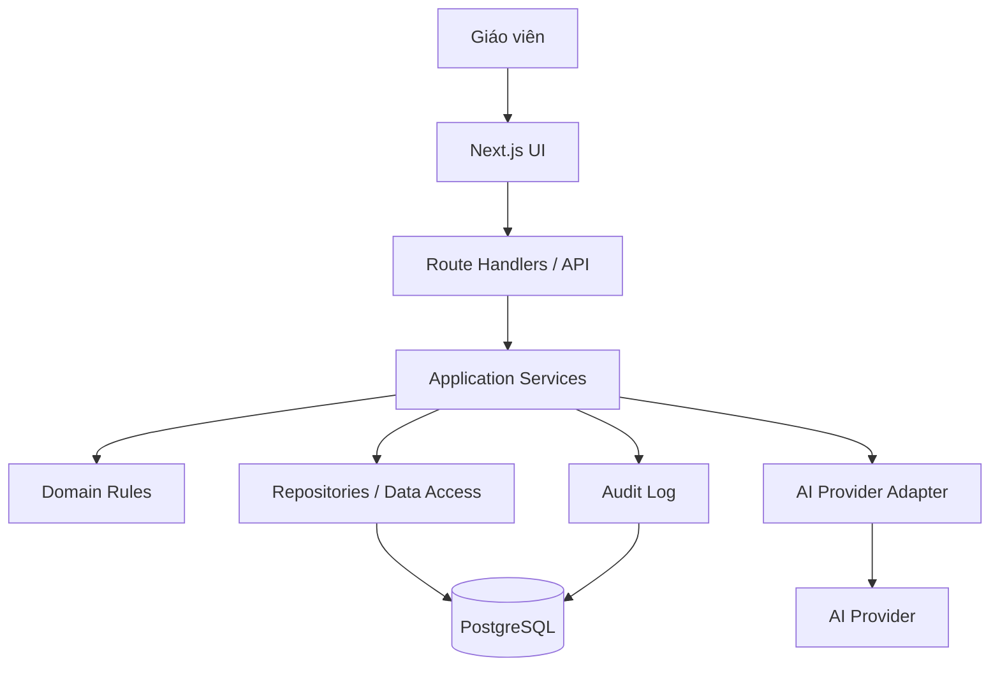
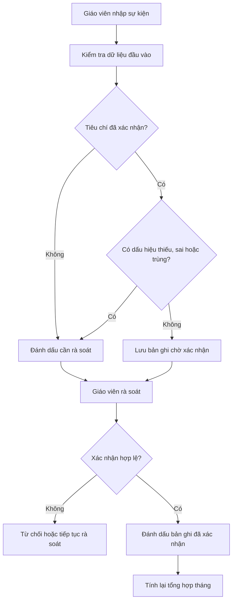
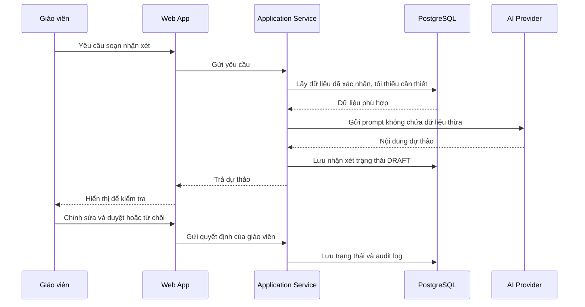

# AI ClassMate 2G3 — System Architecture V1.0

- **Mã tài liệu:** ACM2G3-ARCH
- **Phiên bản:** 1.0
- **Trạng thái:** Bản kiến trúc đề xuất — cần rà soát trước khi triển khai
- **Ngày:** 2026-10-10
- **Dự án:** AI ClassMate 2G3
- **Tài liệu liên quan:**
  - `AI_ClassMate_2G3_De_Cuong_Va_Ke_Hoach_Trien_Khai.md`
  - `AI_ClassMate_2G3_Quy_Tac_Nghiep_Vu_v1_final.md`
  - `AI_ClassMate_2G3_Quy_Tac_Chua_Xac_Nhan.md`
  - `AI_ClassMate_2G3_Database_Design_V1.md`
  - `AI_ClassMate_2G3_SQL_Schema_V1.sql`
- **Phạm vi:** MVP web app hỗ trợ công tác chủ nhiệm lớp tiểu học.

> **Trạng thái quyết định:** Đây là kiến trúc đề xuất để thống nhất trước khi code, không phải mô tả một hệ thống đã được triển khai. Những mục ghi `PENDING_DECISION` cần được chốt trước khi xây dựng chức năng tương ứng.

---

## 1. Mục tiêu kiến trúc

Kiến trúc AI ClassMate 2G3 cần đáp ứng các mục tiêu:

1. Hỗ trợ giáo viên quản lý danh sách học sinh và ghi nhận thi đua.
2. Kiểm tra dữ liệu thiếu, dữ liệu mâu thuẫn và bản ghi có dấu hiệu trùng.
3. Tính điểm, số quà và điểm dư bằng logic ứng dụng xác định, dựa trên quy tắc đã được xác nhận.
4. Tạo tổng kết tháng có thể truy vết về các bản ghi nguồn.
5. Sử dụng AI để hỗ trợ soạn nhận xét và đề xuất hướng hỗ trợ; giáo viên luôn kiểm tra và phê duyệt.
6. Bảo vệ dữ liệu học sinh, hạn chế quyền truy cập và không đưa dữ liệu thật vào demo công khai.
7. Có thể phát triển thêm module trong tương lai mà không phải viết lại toàn bộ ứng dụng.

## 2. Phạm vi MVP

### 2.1. Bao gồm

- Dashboard tổng quan lớp.
- Danh sách và hồ sơ tối thiểu của học sinh.
- Danh mục tiêu chí thi đua và trạng thái xác nhận.
- Ghi nhận sự kiện thi đua theo từng học sinh.
- Kiểm tra dữ liệu và danh sách cảnh báo.
- Tính tổng điểm, số quà, điểm dư theo quy tắc đã xác nhận.
- Tổng kết tháng và trạng thái chờ rà soát/duyệt.
- Tạo nhận xét AI ở dạng dự thảo.
- Giáo viên chỉnh sửa, duyệt hoặc từ chối nhận xét.
- Nhật ký các thay đổi quan trọng.
- Nhập dữ liệu thử nghiệm đã ẩn danh.

### 2.2. Chưa bao gồm trong MVP đầu tiên

- Ứng dụng Flutter/mobile riêng.
- Tích hợp hệ thống quản lý học sinh của trường.
- Tự động gửi thông báo đến phụ huynh.
- Xếp hạng công khai học sinh.
- AI tự quyết định điểm, danh hiệu hoặc kết quả giáo dục.
- Nhiều trường với mô hình phân quyền phức tạp.
- Tự động nhập và hợp thức hóa toàn bộ dữ liệu Excel cũ mà không có bước rà soát.

Các phạm vi này chỉ được bổ sung khi có nhu cầu, quy tắc và yêu cầu bảo mật rõ ràng.

## 3. Quyết định công nghệ đề xuất

| Thành phần | Lựa chọn cho MVP | Lý do |
|---|---|---|
| Frontend | Next.js + TypeScript | Xây dựng giao diện và định tuyến trong một ứng dụng web |
| UI styling | Tailwind CSS | Phát triển giao diện nhanh, nhất quán |
| Backend | Next.js Route Handlers / server-side application services | Giảm số dịch vụ phải vận hành trong MVP |
| Database | PostgreSQL | Hỗ trợ quan hệ, ràng buộc, giao dịch và JSONB cho nhật ký |
| Data access | Một lớp repository/data-access rõ ràng | Tránh để UI truy cập database trực tiếp |
| AI integration | Server-side AI provider adapter | Giữ API key phía server và dễ thay nhà cung cấp |
| Validation | Schema validation tại biên API và kiểm tra nghiệp vụ ở application/domain layer | Không tin dữ liệu đầu vào từ trình duyệt |
| Testing | Unit test cho quy tắc; integration test cho database/API; acceptance test cho luồng giáo viên | Kiểm tra đúng nghiệp vụ trước khi demo |

**Quyết định cho MVP:** Chưa tách Spring Boot thành backend riêng ở giai đoạn đầu. Có thể cân nhắc tách backend sau khi nghiệp vụ ổn định hoặc có yêu cầu triển khai riêng. Nếu tách sau này, domain rules và hợp đồng API phải được giữ rõ ràng để tránh phụ thuộc vào giao diện Next.js.

### Các quyết định còn mở

- `PENDING_DECISION`: Dùng ORM/query builder hay SQL truy vấn trực tiếp. Lựa chọn phải nhất quán với stack đã chốt và khả năng bảo trì.
- `PENDING_DECISION`: Cơ chế đăng nhập thật cho bản demo có dữ liệu thật.
- `PENDING_DECISION`: Nơi triển khai ứng dụng và PostgreSQL.
- `PENDING_DECISION`: Nhà cung cấp AI và chính sách lưu/truyền dữ liệu.

## 4. Kiến trúc logic

MVP được tổ chức theo **modular monolith**: một ứng dụng triển khai đơn giản nhưng chia module và tầng trách nhiệm rõ ràng.



### 4.1. Presentation layer

Chịu trách nhiệm:
- Hiển thị dashboard, danh sách học sinh, biểu mẫu ghi nhận và tổng kết.
- Hiển thị trạng thái `DRAFT`, `NEEDS_REVIEW`, `READY` và `APPROVED`.
- Hiển thị cảnh báo và yêu cầu xác nhận.
- Thu thập thao tác người dùng và gửi request đến server.

Không được:
- Tự tính điểm chính thức trong component giao diện.
- Gọi trực tiếp database.
- Gọi nhà cung cấp AI bằng API key phía trình duyệt.
- Tự chuyển dữ liệu trống thành 0.

### 4.2. API / application layer

Chịu trách nhiệm:
- Kiểm tra request và quyền truy cập.
- Gọi nghiệp vụ theo use case.
- Điều phối giao dịch database.
- Tạo cảnh báo và nhật ký kiểm toán.
- Gọi AI adapter khi use case cần tạo nhận xét dự thảo.
- Trả lỗi và trạng thái rõ ràng cho giao diện.

### 4.3. Domain layer

Chứa logic nghiệp vụ không phụ thuộc UI hoặc nhà cung cấp AI, ví dụ:
- Xác định bản ghi có đủ điều kiện được tính điểm hay không.
- Tính tổng điểm từ các mục đã xác nhận.
- Tính số quà và điểm dư theo BR-003, BR-005, BR-006.
- Phát hiện trạng thái cần rà soát.
- Kiểm tra điều kiện chuyển trạng thái tổng kết.

**Ranh giới bắt buộc:** Không đưa công thức tính điểm chính thức vào prompt AI. Không dùng AI để quyết định điểm.

### 4.4. Infrastructure layer

Chịu trách nhiệm:
- Kết nối PostgreSQL.
- Thực thi truy vấn và giao dịch.
- Lưu audit logs.
- Tích hợp AI provider.
- Đọc cấu hình và secrets từ biến môi trường phía server.
- Ghi log kỹ thuật mà không làm lộ dữ liệu học sinh không cần thiết.

## 5. Module nghiệp vụ

### MOD-01 — Class & Student Management

- Quản lý lớp và danh sách học sinh.
- Dùng `student_code` nội bộ để định danh.
- Chỉ lưu thông tin học sinh thực sự cần thiết.
- Không cho phép xóa cứng học sinh đã có dữ liệu thi đua.

### MOD-02 — Behavior Criteria

- Hiển thị danh mục tiêu chí.
- Quản lý trạng thái xác nhận của tiêu chí.
- Chỉ tiêu chí đã xác nhận mới được dùng để tính điểm chính thức.
- Tiêu chí chưa xác nhận phải được đánh dấu rõ và không tự áp dụng mức điểm.

### MOD-03 — Behavior Recording

- Tạo bản ghi sự kiện và các mục hành vi.
- Lưu thời gian, nguồn nhập, người nhập và trạng thái.
- Hỗ trợ ghi nhận nhiều hành vi khác nhau trong cùng một sự việc.
- Cảnh báo khả năng trùng nhưng không tự xóa dữ liệu.

### MOD-04 — Data Validation & Review

- Phát hiện ô trống, tiêu chí chưa xác nhận, điểm không khớp quy tắc và bản ghi nghi trùng.
- Tạo `review_issues`.
- Cho phép người có thẩm quyền xử lý và ghi lại kết quả rà soát.
- Ngăn chốt kết quả chính thức khi còn lỗi chặn ảnh hưởng đến kết quả.

### MOD-05 — Monthly Summary

- Tổng hợp các bản ghi đã xác nhận.
- Tính điểm cộng, điểm trừ và tổng điểm.
- Tính số quà và điểm dư theo các quy tắc đã xác nhận.
- Lưu phiên bản quy tắc dùng để tính.
- Phân biệt kết quả tạm tính và kết quả đã duyệt.

### MOD-06 — AI Comment Assistant

- Nhận dữ liệu đã được xác nhận và tối thiểu cần thiết.
- Tạo nhận xét dự thảo mang tính xây dựng, cụ thể và phù hợp lứa tuổi.
- Không suy đoán tính cách, chẩn đoán, hoàn cảnh gia đình hoặc nguyên nhân không có trong dữ liệu.
- Giáo viên có thể sửa, duyệt hoặc từ chối.
- Không tự gửi hoặc công bố nhận xét.

### MOD-07 — Audit & Reporting

- Lưu lịch sử tạo, sửa, xác nhận, từ chối, duyệt và mở lại tổng kết.
- Cho phép truy vết từ tổng kết về dữ liệu nguồn.
- Báo cáo công khai/demo dùng dữ liệu giả lập hoặc đã ẩn danh.

## 6. Luồng dữ liệu cốt lõi

### 6.1. Ghi nhận thi đua



### 6.2. Tổng kết tháng

1. Lấy các mục hành vi hợp lệ đã được xác nhận trong tháng.
2. Kiểm tra các vấn đề còn mở có thể ảnh hưởng tổng điểm.
3. Nếu có lỗi chặn, đặt tổng kết thành `NEEDS_REVIEW`.
4. Nếu dữ liệu hợp lệ, tính điểm bằng code theo quy tắc nghiệp vụ.
5. Nếu tổng điểm âm: số quà bằng 0, giữ nguyên điểm âm, điểm dư không áp dụng.
6. Nếu tổng điểm không âm: số quà bằng `FLOOR(total_points / 10)`, điểm dư bằng `total_points - gift_count * 10`.
7. Giáo viên kiểm tra và duyệt tổng kết.
8. Lưu thời điểm duyệt, người duyệt và phiên bản quy tắc.

### 6.3. Tạo nhận xét bằng AI



Nếu AI provider lỗi hoặc không khả dụng, hệ thống vẫn phải cho phép quản lý dữ liệu, kiểm tra điểm và tổng kết không phụ thuộc AI.

## 7. API boundary đề xuất

API cụ thể sẽ được đặc tả trong tài liệu API riêng. Nhóm endpoint dự kiến:

| Nhóm | Ví dụ endpoint | Trách nhiệm |
|---|---|---|
| Classes | `GET /api/classes` | Lấy danh sách lớp |
| Students | `GET /api/students`, `POST /api/students` | Tra cứu và quản lý học sinh |
| Criteria | `GET /api/behavior-criteria` | Tra cứu tiêu chí |
| Events | `POST /api/behavior-events` | Tạo sự kiện thi đua |
| Events | `POST /api/behavior-events/{id}/confirm` | Xác nhận sự kiện |
| Reviews | `GET /api/review-issues` | Lấy danh sách cảnh báo |
| Reviews | `POST /api/review-issues/{id}/resolve` | Xử lý cảnh báo |
| Summaries | `GET /api/monthly-summaries?year=YYYY&month=MM` | Xem tổng kết tháng |
| Summaries | `POST /api/monthly-summaries/{id}/recalculate` | Tính lại tổng hợp |
| Summaries | `POST /api/monthly-summaries/{id}/approve` | Duyệt tổng kết |
| AI Comments | `POST /api/students/{id}/comments/draft` | Tạo nhận xét dự thảo |
| AI Comments | `POST /api/comments/{id}/approve` | Duyệt nhận xét |
| Audit | `GET /api/audit-logs` | Tra cứu lịch sử theo quyền |

Các endpoint trên là bản phác thảo, chưa phải hợp đồng API cuối cùng. Phải kiểm tra xác thực, phân quyền, validation, xử lý lỗi và nhật ký trước khi triển khai.

## 8. Bảo mật và quyền riêng tư

### 8.1. Nguyên tắc

- Chỉ thu thập dữ liệu tối thiểu cần cho mục tiêu giáo dục.
- Dùng mã học sinh trong dữ liệu thử nghiệm, ảnh chụp và demo.
- Không công khai bảng xếp hạng cá nhân.
- Không đưa dữ liệu định danh học sinh vào prompt AI nếu không cần thiết.
- API key AI chỉ được lưu ở biến môi trường server-side.
- Không ghi nội dung nhạy cảm của học sinh vào log kỹ thuật nếu không cần.
- Giới hạn truy cập theo vai trò và phạm vi lớp.
- Có sao lưu và quy trình khôi phục trước khi dùng dữ liệu thật.
- Không coi việc có tài khoản giáo viên là đủ; phải xác thực và kiểm tra quyền ở server.

### 8.2. Trước khi dùng dữ liệu thật

Cần chốt:
- Cơ chế đăng nhập và phân quyền.
- Ai được xem, nhập, sửa, duyệt và xuất dữ liệu.
- Nơi lưu trữ và thời gian lưu dữ liệu.
- Chính sách gửi dữ liệu đến nhà cung cấp AI.
- Quy trình sao lưu, khôi phục và xử lý sự cố.
- Quy định áp dụng của nhà trường và yêu cầu bảo vệ dữ liệu trẻ em.

Không dùng dữ liệu thật trên môi trường demo công khai nếu các điểm này chưa được xử lý.

## 9. Quan sát, lỗi và khả năng phục hồi

- Trả thông báo lỗi dễ hiểu cho người dùng, không lộ stack trace.
- Ghi log kỹ thuật có mã tương quan request khi phù hợp.
- Ghi audit log riêng cho thay đổi nghiệp vụ quan trọng.
- Dùng giao dịch database cho thao tác cập nhật nhiều bảng liên quan.
- Xử lý trường hợp gửi lại request để tránh tạo trùng sự kiện hoặc duyệt hai lần.
- Nếu AI timeout/lỗi, giữ dữ liệu nghiệp vụ đã lưu và cho phép thử lại.
- Không đánh dấu thao tác thành công trước khi server xác nhận thành công.

## 10. Cấu trúc thư mục ứng dụng đề xuất

```text
src/
├── app/
│   ├── (dashboard)/
│   │   ├── dashboard/
│   │   ├── students/
│   │   ├── behavior/
│   │   ├── reviews/
│   │   ├── summaries/
│   │   └── settings/
│   └── api/
├── modules/
│   ├── students/
│   │   ├── domain/
│   │   ├── application/
│   │   ├── infrastructure/
│   │   └── presentation/
│   ├── behavior/
│   ├── reviews/
│   ├── summaries/
│   └── ai-comments/
├── shared/
│   ├── database/
│   ├── auth/
│   ├── validation/
│   ├── errors/
│   └── audit/
└── tests/
    ├── unit/
    ├── integration/
    └── acceptance/
```

Đây là cấu trúc tham khảo. Khi khởi tạo project cần kiểm tra quy ước Next.js hiện hành và chọn một cách tổ chức nhất quán; không bắt buộc tạo đủ mọi thư mục trống ngay từ đầu.

## 11. Các quyết định kiến trúc (ADR)

### ADR-001 — Modular monolith cho MVP

- **Trạng thái:** Đề xuất.
- **Quyết định:** Dùng một ứng dụng Next.js với module và tầng nghiệp vụ rõ ràng.
- **Lý do:** Giảm độ phức tạp triển khai, phù hợp MVP và thời gian nghiên cứu.
- **Hệ quả:** Cần giữ domain logic độc lập để có thể tách backend sau này nếu cần.

### ADR-002 — Logic điểm phải xác định bằng code

- **Trạng thái:** Bắt buộc.
- **Quyết định:** Tính điểm và quy đổi quà bằng code theo quy tắc đã xác nhận.
- **Lý do:** Kết quả phải kiểm thử được, lặp lại được và truy vết được.
- **Hệ quả:** AI không quyết định điểm; quy tắc chưa xác nhận phải tạo cảnh báo hoặc chờ duyệt.

### ADR-003 — AI chỉ tạo nội dung dự thảo

- **Trạng thái:** Bắt buộc.
- **Quyết định:** Nhận xét AI mặc định là bản nháp và cần giáo viên duyệt.
- **Lý do:** Giáo viên giữ quyền quyết định và tránh nội dung sai lệch về học sinh.
- **Hệ quả:** Lưu trạng thái, người duyệt và thời điểm duyệt.

### ADR-004 — PostgreSQL là database mục tiêu

- **Trạng thái:** Đề xuất, cần xác nhận môi trường triển khai.
- **Quyết định:** Thiết kế schema theo PostgreSQL.
- **Lý do:** Phù hợp dữ liệu quan hệ, ràng buộc và nhật ký JSONB.
- **Hệ quả:** SQL phải được chạy thử trên database phát triển trước khi sử dụng chính thức.

### ADR-005 — Chưa đưa dữ liệu học sinh thật vào demo công khai

- **Trạng thái:** Bắt buộc.
- **Quyết định:** Dùng dữ liệu giả lập hoặc đã ẩn danh trong demo và kiểm thử.
- **Lý do:** Giảm rủi ro lộ thông tin của trẻ em.
- **Hệ quả:** Tách seed dữ liệu demo khỏi dữ liệu vận hành thật.

## 12. Rà soát SQL Schema trước khi migration

SQL Schema V1 hiện là bản khởi đầu và phải được rà soát so với kiến trúc trước khi áp dụng. Cần kiểm tra ít nhất:

- [ ] Đảm bảo `behavior_events.student_id` thuộc cùng lớp với `behavior_events.class_id`.
- [ ] Đảm bảo `monthly_summaries.student_id` thuộc cùng lớp với `monthly_summaries.class_id`.
- [ ] Chốt cách lưu phiên bản tiêu chí để thay đổi mức điểm không làm thay đổi lịch sử.
- [ ] Xác định quy tắc xác nhận cho `behavior_event_items` và tổng hợp tháng.
- [ ] Rà soát các `CHECK` constraint để phản ánh chính xác trạng thái hợp lệ.
- [ ] Kiểm thử tạo bảng trên database phát triển sạch.
- [ ] Chuẩn bị migration có phiên bản; tránh chỉnh sửa schema thủ công không ghi nhận.
- [ ] Tách seed demo khỏi dữ liệu học sinh thật.

Không xem SQL Schema V1 là production-ready trước khi các mục cần thiết được xử lý.

## 13. Tiêu chí nghiệm thu kiến trúc

- [ ] Các module có trách nhiệm rõ ràng.
- [ ] UI không truy cập trực tiếp database.
- [ ] Tính điểm không phụ thuộc AI.
- [ ] Tiêu chí chưa xác nhận không được áp dụng cho kết quả chính thức.
- [ ] Dữ liệu thiếu được phân biệt với điểm 0.
- [ ] Tổng kết có thể truy vết về bản ghi nguồn và phiên bản quy tắc.
- [ ] Nhận xét AI phải được giáo viên duyệt.
- [ ] API key không xuất hiện trong mã frontend hoặc repository.
- [ ] Có audit log cho thao tác nghiệp vụ quan trọng.
- [ ] Có bộ kiểm thử cho dữ liệu hợp lệ, thiếu, sai và nghi trùng.
- [ ] Dữ liệu demo được tách khỏi dữ liệu thật.

## 14. Bước tiếp theo sau Architecture

1. Rà soát và xác nhận các quyết định kiến trúc còn mở.
2. Tạo `API_Design_V1.md` để đặc tả endpoint, request/response, validation và lỗi.
3. Tạo `Security_Design_V1.md` để chốt xác thực, phân quyền và bảo vệ dữ liệu.
4. Rà soát SQL Schema theo architecture rồi mới chạy migration.
5. Khởi tạo Next.js project và triển khai từng module theo thứ tự: học sinh → ghi nhận thi đua → rà soát → tổng kết → AI nhận xét.

## 15. Nhật ký thay đổi

| Phiên bản | Ngày | Nội dung | Trạng thái |
|---|---|---|---|
| 1.0 | 2026-10-10 | Đề xuất kiến trúc MVP, module, luồng dữ liệu, API boundary, bảo mật và các quyết định kỹ thuật | Chờ rà soát |
