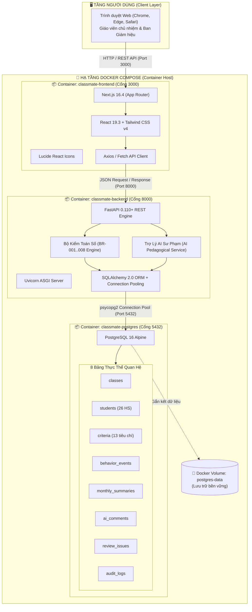
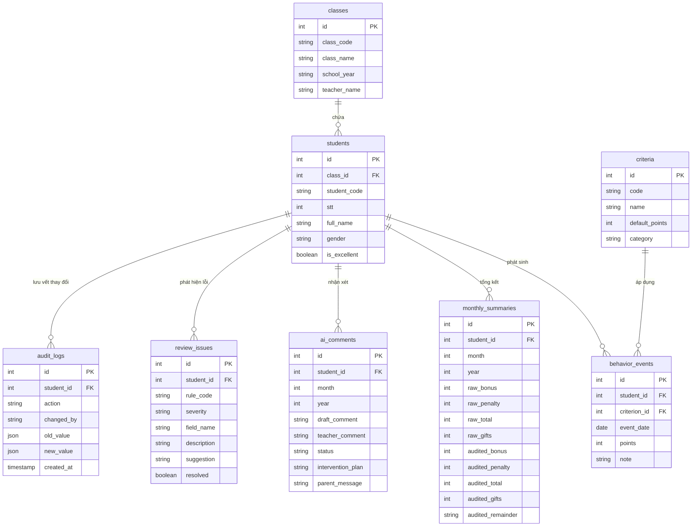

# 🏗️ AI ClassMate 2G3 — Báo Cáo Thiết Kế Kiến Trúc Hệ Thống (Architecture Specification)

> **Đề tài Nghiên cứu Khoa học Giáo dục — Hội thi Nhà giáo sáng tạo với công nghệ số và trí tuệ nhân tạo 2026**  
> **Căn cứ pháp lý:** Công văn số 4723/UBND-VHXH ngày 07/10/2026  
> **Đơn vị thực nghiệm:** Lớp 2G3 — Trường Tiểu học Núi Thành (Phân hiệu 6)  
> **Mã tài liệu:** ACM2G3-ARCH-V2  
> **Phiên bản:** 2.0 (Official Production Docker & PostgreSQL Architecture)  
> **Ngày phê duyệt:** 07/11/2026  
> **Trạng thái:** Đã triển khai và đóng gói 100% Docker Containerization (Đã loại bỏ hoàn toàn SQLite)

---

## 1. Tóm tắt điều hành (Executive Summary)

Hệ thống **AI ClassMate 2G3** được thiết kế theo mô hình **Kiến trúc phân tán hiện đại (Decoupled 3-Tier Microservices Architecture)**, đóng gói hoàn chỉnh bằng **Docker & Docker Compose**. 

Hệ thống bao gồm 3 phân hệ độc lập:
1. **Frontend Service (Next.js 16 + React 19 + Tailwind CSS v4):** Giao diện điều hành thời gian thực phục vụ giáo viên chủ nhiệm và ban giám hiệu.
2. **Backend Service (Python 3.11 + FastAPI + SQLAlchemy 2.0):** Cung cấp hệ thống REST API, tích hợp bộ máy kiểm toán số **BR-Engine** (chuẩn hóa quy tắc BR-001..008) và Trợ lý AI sư phạm.
3. **Database Service (PostgreSQL 16 Alpine Container):** Cơ sở dữ liệu quan hệ duy nhất và duy trì tính toàn vẹn dữ liệu cho toàn bộ hệ sinh thái (đã xóa bỏ hoàn toàn SQLite ngoại tuyến để đảm bảo tính tập trung và chuẩn mực NCKH).

---

## 2. Sơ đồ kiến trúc tổng thể (System Architecture Diagram)

---

## 3. Bảng chi tiết toàn bộ ngăn xếp công nghệ (Technology Stack)

### 3.1. Bảng công nghệ phân tầng

| Tầng kiến trúc | Công nghệ / Thư viện | Phiên bản | Vai trò & Mục đích sử dụng trong dự án |
| :--- | :--- | :---: | :--- |
| **Cơ sở dữ liệu** | **PostgreSQL** *(Alpine)* | **16** | CSDL quan hệ duy nhất của dự án, lưu trữ 8 bảng dữ liệu chuẩn hóa (học sinh, thi đua, vi phạm, nhận xét AI...). Chạy cô lập trong container `classmate-postgres` với Docker volume bền vững. |
| **Kết nối CSDL** | **SQLAlchemy ORM** | **2.0+** | Quản lý mô hình dữ liệu (ORM), tự động tạo bảng, tối ưu truy vấn và quản lý Connection Pooling. |
| **Driver CSDL** | **psycopg2-binary** | **2.9.9+** | Trình điều khiển kết nối tốc độ cao giữa mã nguồn Python FastAPI và cơ sở dữ liệu PostgreSQL. |
| **Backend Framework** | **FastAPI** | **0.110+** | Framework xây dựng REST API hiệu năng cao, tự động kiểm tra dữ liệu và sinh tài liệu Swagger UI. |
| **Backend Server** | **Uvicorn** | **0.28+** | Máy chủ ASGI server chạy mã nguồn Python Backend tại cổng 8000. |
| **Xác thực dữ liệu** | **Pydantic** | **2.6+** | Kiểm tra kiểu dữ liệu chặt chẽ cho các gói tin API gửi/nhận (Schemas). |
| **Phân tích số liệu** | **Pandas / Numpy** | **2.2+** | Xử lý, tính toán các chỉ số thực nghiệm đối chứng NCKH và thống kê thi đua. |
| **Frontend Framework**| **Next.js (App Router)** | **16.4** | Framework React hiện đại nhất, hỗ trợ Server/Client Rendering cho giao diện mượt mà. |
| **Thư viện UI cốt lõi** | **React** | **19.3** | Thư viện xây dựng các Component giao diện tương tác thời gian thực. |
| **Ngôn ngữ Frontend** | **TypeScript** | **5.x** | Đảm bảo an toàn kiểu dữ liệu tĩnh cho toàn bộ mã nguồn giao diện. |
| **Styling & Giao diện** | **Tailwind CSS** | **v4** | Framework CSS tiện ích, thiết kế giao diện chuẩn Responsive cho máy tính và máy tính bảng. |
| **Bộ Icon** | **Lucide React** | **1.55+** | Bộ biểu tượng đồ họa hiện đại cho 6 phân hệ giao diện. |
| **Xử lý bảng tính** | **SheetJS (xlsx)** | **0.18+** | Hỗ trợ đọc/xuất và đối chứng dữ liệu với file Excel gốc của lớp 2G3. |
| **Ảo hóa & Đóng gói** | **Docker** | **24+** | Đóng gói toàn bộ ứng dụng thành các container độc lập, không phụ thuộc vào hệ điều hành máy chủ. |
| **Điều phối dịch vụ** | **Docker Compose** | **v2+** | Quản lý đồng thời 3 container (`postgres`, `backend`, `frontend`) và cơ chế tự động Healthcheck CSDL. |
| **Kiểm thử hệ thống** | **Node.js Test Runner** | **Native** | Bộ kịch bản tự động xác thực 17 tiêu chí nghiệp vụ (BR-001..BR-008) và tính toàn vẹn cấu trúc dự án. |

---

### 3.2. Bảng phân bổ dịch vụ mạng và cổng kết nối (Port & Network Mapping)

| Tên Service Docker | Tên Container | Cổng nội bộ container | Cổng ánh xạ ra máy chủ (Host) | Nhiệm vụ chính |
| :--- | :--- | :---: | :---: | :--- |
| **`postgres`** | `classmate-postgres` | `5432` | `5432` *(hoặc `5433`)* | Lưu trữ dữ liệu thực nghiệm, quản lý quan hệ và toàn vẹn dữ liệu. |
| **`backend`** | `classmate-backend` | `8000` | `8000` | Cung cấp REST API, chạy bộ kiểm toán số và sinh nhận xét AI. |
| **`frontend`** | `classmate-frontend` | `3000` | `3000` | Giao diện Next.js tương tác trực tiếp với giáo viên chủ nhiệm. |

---

## 4. Thiết kế Cơ sở dữ liệu quan hệ PostgreSQL (8 Tables)

Hệ thống được thiết kế với **8 bảng thực thể chuẩn hóa** đảm bảo chuẩn dạng 3 (3NF), loại bỏ hoàn toàn tình trạng dư thừa dữ liệu và hỗ trợ truy vết lịch sử:

### Danh sách 8 bảng nghiệp vụ chi tiết:
1. **`classes`**: Thông tin lớp học (Lớp 2G3 - Trường TH Núi Thành, Năm học 2026-2027).
2. **`students`**: Danh sách 26 học sinh thực nghiệm (Mã học sinh, Họ tên, Giới tính, Đạt học sinh xuất sắc).
3. **`criteria`**: 13 tiêu chí thi đua đã được chuẩn hóa theo quy chế nhà trường (Điểm phát biểu +1, Vở sạch chữ đẹp +2, Vi phạm cờ đỏ -10...).
4. **`behavior_events`**: Nhật ký chi tiết các sự kiện rèn luyện theo từng ngày của học sinh.
5. **`monthly_summaries`**: Bảng tổng hợp thi đua tháng 9/2026, đối chứng số liệu thô từ Excel với số liệu đã được kiểm toán tự động.
6. **`ai_comments`**: Bản nháp nhận xét AI theo giọng điệu sư phạm, kế hoạch can thiệp và phê duyệt của giáo viên.
7. **`review_issues`**: Danh mục các sai sót/cảnh báo được bộ kiểm toán BR phát hiện tự động.
8. **`audit_logs`**: Nhật ký lưu vết toàn bộ lịch sử chỉnh sửa điểm số theo quy định BR-004.

---

## 5. Đặc tả bộ máy kiểm toán số (Business Rules Engine: BR-001 đến BR-008)

Toàn bộ logic tính điểm và kiểm soát sai sót trong hệ thống được vận hành bởi bộ quy tắc nghiệp vụ đã được xác nhận:

| Mã Quy Tắc | Tên quy tắc nghiệp vụ | Định nghĩa thuật toán kỹ thuật |
| :---: | :--- | :--- |
| **BR-001** | Xử lý ô điểm trống | Ô trống = `DỮ LIỆU CHƯA XÁC NHẬN`. Hệ thống phát hiện và gắn cờ cảnh báo `BLOCKING` thay vì mặc định tự coi là 0. |
| **BR-002** | Vi phạm cờ đỏ | Vi phạm cờ đỏ trừ cố định **10 điểm**. Bắt cảnh báo nếu bảng tính thủ công chỉ trừ 5 điểm hoặc ghi nhận sai. |
| **BR-003** | Điểm âm không đổi quà | Nếu $\text{Tổng điểm} < 0$: $\text{Số quà} = 0$, $\text{Điểm dư} = \text{"N/A"}$. Không áp dụng phép chia làm tròn sai. |
| **BR-004** | Bảo toàn dữ liệu gốc | Không ghi đè trực tiếp lên dữ liệu nguồn; mọi thao tác điều chỉnh của giáo viên đều được ghi vào bảng `audit_logs`. |
| **BR-005** | Công thức tính quà chuẩn | Khi $\text{Tổng điểm} \ge 0$: $\text{Số quà} = \lfloor \frac{\text{Tổng điểm}}{10} \rfloor$. |
| **BR-006** | Công thức tính điểm dư | Khi $\text{Tổng điểm} \ge 0$: $\text{Điểm dư} = \text{Tổng điểm} - (\text{Số quà} \times 10)$. |
| **BR-007** | Xử lý vi phạm kép | Lỗi "nói chuyện + nói leo" trong cùng một tiết học = Trừ **2 điểm** (gồm 2 vi phạm độc lập: $-1$ và $-1$). |
| **BR-008** | Chống tính trùng lặp | Không tính trùng cùng một hành vi vi phạm trong cùng một lần ghi nhận sự kiện. |

---

## 6. Mô hình Trợ lý AI Sư Phạm (Pedagogical AI Engine)

Trợ lý AI được thiết kế tuân thủ nguyên tắc **Human-in-the-loop** (Con người làm chủ công nghệ):
- **Cơ sở dữ liệu đầu vào:** Minh chứng thực tế từ bảng `behavior_events` và `monthly_summaries` (tổng điểm, điểm cộng, lỗi nhắc nhở cụ thể).
- **Tùy biến giọng điệu sư phạm (Pedagogical Tone):**
  - `ENCOURAGING` (Động viên khích lệ): Dành cho học sinh có điểm thi đua tốt hoặc học sinh có cố gắng vươn lên.
  - `BALANCED` (Cân bằng, khách quan): Nêu rõ ưu điểm và chỉ rõ các lỗi nề nếp cần chấn chỉnh.
  - `INTERVENTION` (Kế hoạch can thiệp): Xây dựng mục tiêu tuần tiếp theo và mẫu trao đổi với phụ huynh.
- **Quyền quyết định tối cao thuộc về GVCN:** AI chỉ tạo dự thảo (`DRAFT`), giáo viên trực tiếp duyệt (`APPROVED`) hoặc chỉnh sửa câu từ trước khi công bố.

---

## 7. Khởi chạy và Vận hành qua Docker Compose

### 7.1. Cấu hình Docker Compose chuẩn (`docker-compose.yml`)
Toàn bộ hệ thống được định nghĩa trong tệp `docker-compose.yml` gồm 3 services:
- Khởi động service `postgres` trước, kiểm tra `healthcheck` đạt trạng thái `healthy`.
- Service `backend` tự động kết nối vào PostgreSQL, khởi tạo cấu trúc bảng và nạp sẵn 26 học sinh lớp 2G3.
- Service `frontend` hoàn tất build production và kết nối tới Backend API.

### 7.2. Lệnh vận hành hệ thống

* **Khởi chạy tự động 1 chạm trên Windows:**  
  Nhấp đúp chuột vào file **`run.bat`** (Tự động kiểm tra Docker, bật container và mở trình duyệt).

* **Khởi chạy thủ công bằng Docker CLI:**  
  `docker compose up -d --build`

* **Kiểm tra trạng thái container:**  
  `docker compose ps`

* **Dừng toàn bộ hệ thống:**  
  `docker compose down`

* **Khởi tạo lại toàn bộ dữ liệu CSDL sạch:**  
  `docker compose down -v`

---

## 8. Kết quả nghiệm thu và Đảm bảo chất lượng (QA & Testing)

Dự án đã trải qua bộ kiểm thử tự động toàn diện tại tệp `test_system.js`:
- **Số lượng ca kiểm thử:** **17/17 Unit Tests PASS (100%)**.
- **Phạm vi kiểm thử:**
  - Logic tính điểm và đổi quà (BR-001..008).
  - Thuật toán kiểm toán rà soát sai sót dữ liệu.
  - Cấu hình kết nối PostgreSQL thuần Docker.
  - Tính toàn vẹn cấu trúc mã nguồn Backend và Frontend.
  - Không còn bất kỳ sự phụ thuộc nào vào SQLite.

---

*Tài liệu này là căn cứ kỹ thuật chính thức phục vụ công tác báo cáo, thuyết minh đề tài tại Hội thi Nhà giáo sáng tạo với công nghệ số và trí tuệ nhân tạo 2026.*

